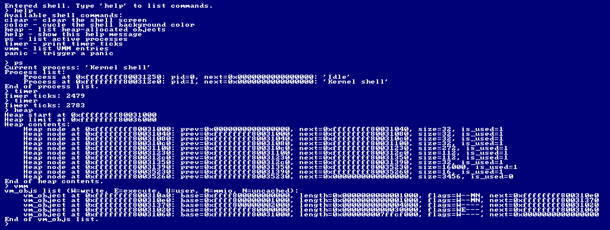

# x64-kernel

A hobby x86-64 kernel in C, booted with Limine.



## Features

- Boots via Limine (BIOS and UEFI)
- GDT, IDT and CPU exception handling
- Bitmap physical frame allocator, 4-level paging VMM, kernel heap
- ACPI parsing (RSDP/MADT) to find the Local APIC and I/O APIC
- PIT-driven preemptive round-robin scheduler (kernel tasks)
- PS/2 keyboard driver and framebuffer text rendering
- Interactive shell with commands like `help`, `ps`, `heap`, `vmm`, `timer`, `color`, `clear`
- Kernel panics with stack trace

Todo: userspace, syscalls, filesystem, per-process address spaces, guard pages for task stacks, W^X kernel mappings, interrupt-safe heap.

## Building / Running

### Dependencies

Any `make` command depends on GNU make (`gmake`) and is expected to be run using it. This usually means using `make` on most GNU/Linux distros, or `gmake` on other non-GNU systems.

All `make all*` targets depend on a GNU-compatible C toolchain capable of generating x86-64 ELF objects. Usually `gcc/binutils` or `clang/llvm/lld` provided by any x86-64 UNIX like (including Linux) distribution will suffice.

Additionally, building an ISO with `make all` requires `xorriso`, and building a HDD/USB image with `make all-hdd` requires `sgdisk` (usually from `gdisk` or `gptfdisk` packages) and `mtools`.

### Toolchain selection

The `TOOLCHAIN` and `TOOLCHAIN_PREFIX` `make` variables can be used to set the toolchain. `TOOLCHAIN` can be set to `llvm` to use Clang/LLVM.

For example:
```
make TOOLCHAIN=llvm
```
or:
```
make TOOLCHAIN_PREFIX=x86_64-elf-
```

### Makefile targets

| Target         | Action                                                                        |
|----------------|-------------------------------------------------------------------------------|
| `make all`     | Build the kernel and a bootable ISO                                           |
| `make all-hdd` | Build the kernel and a raw HDD image                                          |
| `make run`     | Build the kernel and a bootable ISO, then run it using `qemu` (if installed)  |
| `make run-hdd` | Build the kernel and a raw HDD image, then run it using `qemu` (if installed) |
| `make run-uefi` | Like `make run`, but boots `qemu` with UEFI-compatible firmware              |
| `make run-hdd-uefi` | Like `make run-hdd`, but boots `qemu` with UEFI-compatible firmware      |

A raw HDD image is suitable to be flashed onto a USB stick or hard drive/SSD.

## Credit

These projects and resources were helpful:

- Build system and boot setup based on [Limine C Template](https://github.com/Limine-Bootloader/limine-c-template-x86-64)
- [Osdev-Notes](https://codeberg.org/dreamportdev/Osdev-Notes)
- [osdev.org](https://wiki.osdev.org/Expanded_Main_Page)
- [osdev.wiki](https://osdev.wiki/wiki/Expanded_Main_Page)
